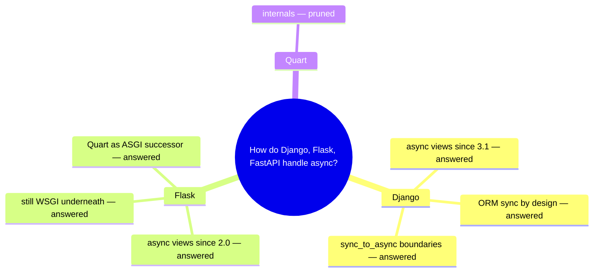
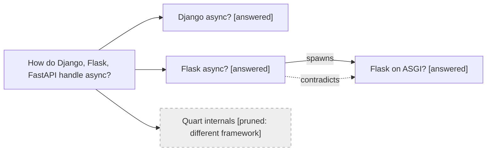

# Narrative report template

SKILL.md's Report section is the contract; this file is the worked example
to match. Rules:

- **Prose, not bullets.** Findings are told as a story in sections, one per
  sub-question. Telegraphic prose — no transitions, no restating the
  question. ~1500 words is a guide, not a wall — length is earned claim by
  claim. Run the tell-scan in `references/prose-hygiene.md` before saving.
- **Citations inline as numbers** `[1]`; URLs appear only in Sources.
- **Weak claims flagged inline** `[3, weak]` — a claim resting on a single
  or secondary source never passes silently.
- **Mind map** — a mermaid `mindmap` right after the summary shows the
  question decomposition at a glance, verdicts inline. The thought graph
  stays in the appendix; it carries the edges the mind map can't show.
- **Background** — context the reader needs before the body: why the
  question matters, key terms, prior state. A few sentences, never a
  history dump. Ground it in what the user supplied at the ask — never
  invent motivation or prior state.
- **Unresolved** carries contradictions, weak claims, and pruned branches —
  silent pruning hides coverage holes.
- **Thought graph** goes in the appendix: `spawns` / `merges` /
  `contradicts` edges, `[verdict]` labels, pruned nodes marked.
- **Sources** numbered to match inline markers, each with confidence.

---

# How do Django, Flask, and FastAPI handle async?

Django, Flask, and FastAPI all run async code, but at different depths:
FastAPI is async-native (built on ASGI), Django layers async onto a
sync-by-design ORM, and Flask offers async views that still run on a
WSGI/event-loop shim — with Quart as its true async successor [1][2][3].

The territory, at a glance:

## Background

Python web frameworks split on async support: WSGI frameworks grew up
serving synchronous requests, while ASGI emerged to bring Python onto the
async mainstream. The choice matters for teams evaluating frameworks for
I/O-heavy workloads — it decides whether a framework can hold many
concurrent connections without threads. The sections below cover each
framework's async story and what it means in practice.

## Django: async views over a sync core

Django has supported ASGI and async views since 3.1, letting handlers call
async libraries directly [1]. The catch is the ORM: it is sync by design,
so async views must wrap database calls in `sync_to_async` (and the
reverse in `async_to_sync`) [1]. The result is real async I/O with explicit
boundaries — a single blocking ORM call in an async view stalls the whole
event loop, so Django's docs treat "running sync code in async contexts" as
a discipline, not a feature [1].

## Flask: async views, WSGI underneath

Flask 2.0 added `async def` views, but it remains a WSGI framework: the
async handlers run on a per-request event loop converted through asgiref,
so concurrency inside a single view works while the request lifecycle stays
synchronous [2]. For native ASGI behavior, the Flask project points to
Quart, which reimplements the Flask API on ASGI [2]. Flask's async support
is a compatibility layer; teams wanting async-native Flask semantics use
Quart instead.

## FastAPI: async-native by construction

FastAPI is built on Starlette and speaks ASGI natively: `async def`
endpoints run on the event loop directly, while sync `def` endpoints are
offloaded to a threadpool [3]. There is no sync core to bridge — the
framework's model is the event loop from the start [3].

## Unresolved

- `sync_to_async` thread-pool contention under real load — acknowledged in
  Django docs, no benchmark consensus found [weak].
- Flask async + SQLAlchemy interactions — surfaced mid-research, pruned:
  framework-specific detail that doesn't change the root answer.
- Quart internals — pruned: different framework.

## Appendix: thought graph

## Sources

1. Django documentation, "Asynchronous support" — https://docs.djangoproject.com/en/stable/topics/async/ — strong
2. Flask documentation, "Async patterns" — https://flask.palletsprojects.com/en/stable/async-await/ — strong
3. FastAPI documentation, "Concurrency and async/await" — https://fastapi.tiangolo.com/async/ — strong